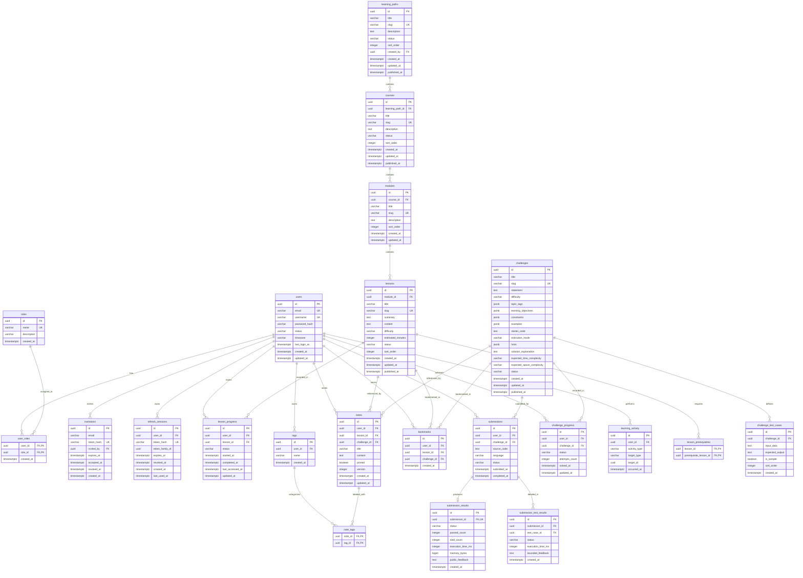

# Go Academy --- Database Architecture & Schema Specification

**Document Version:** 1.0  
**Database Engine:** PostgreSQL 16+  
**Migration Tool:** `golang-migrate`  
**Query Generator:** `sqlc` with `pgx/v5`  

---

## 1. Entity-Relationship Diagram (ERD)



---

## 2. Table Schemas and Constraints

### 2.1 Identity and Access Control

#### `users`
Represents platform accounts (both learners and administrators).
```sql
CREATE TABLE users (
    id UUID PRIMARY KEY DEFAULT gen_random_uuid(),
    email VARCHAR(255) NOT NULL,
    username VARCHAR(50) NOT NULL,
    password_hash VARCHAR(255) NOT NULL,
    status VARCHAR(32) NOT NULL DEFAULT 'active', -- active, disabled
    timezone VARCHAR(64) NOT NULL DEFAULT 'UTC',
    last_login_at TIMESTAMPTZ,
    created_at TIMESTAMPTZ NOT NULL DEFAULT NOW(),
    updated_at TIMESTAMPTZ NOT NULL DEFAULT NOW()
);

-- Case-insensitive uniqueness
CREATE UNIQUE INDEX idx_users_email_lower ON users (LOWER(email));
CREATE UNIQUE INDEX idx_users_username_lower ON users (LOWER(username));
CREATE INDEX idx_users_status ON users (status);
```

#### `roles`
System-defined roles (`admin`, `learner`).
```sql
CREATE TABLE roles (
    id UUID PRIMARY KEY DEFAULT gen_random_uuid(),
    name VARCHAR(32) NOT NULL UNIQUE,
    description TEXT,
    created_at TIMESTAMPTZ NOT NULL DEFAULT NOW()
);
```

#### `user_roles`
Mapping table for User-to-Role assignments.
```sql
CREATE TABLE user_roles (
    user_id UUID NOT NULL REFERENCES users(id) ON DELETE CASCADE,
    role_id UUID NOT NULL REFERENCES roles(id) ON DELETE RESTRICT,
    created_at TIMESTAMPTZ NOT NULL DEFAULT NOW(),
    PRIMARY KEY (user_id, role_id)
);
CREATE INDEX idx_user_roles_role_id ON user_roles (role_id);
```

#### `invitations`
Invite-only registration records. Raw tokens are never persisted.
```sql
CREATE TABLE invitations (
    id UUID PRIMARY KEY DEFAULT gen_random_uuid(),
    email VARCHAR(255) NOT NULL,
    token_hash VARCHAR(64) NOT NULL UNIQUE, -- SHA-256 hex string of 32-byte secret
    invited_by UUID NOT NULL REFERENCES users(id) ON DELETE RESTRICT,
    expires_at TIMESTAMPTZ NOT NULL,
    accepted_at TIMESTAMPTZ,
    revoked_at TIMESTAMPTZ,
    created_at TIMESTAMPTZ NOT NULL DEFAULT NOW()
);

CREATE INDEX idx_invitations_email_lower ON invitations (LOWER(email));
CREATE INDEX idx_invitations_token_hash ON invitations (token_hash);
CREATE INDEX idx_invitations_status ON invitations (expires_at, accepted_at, revoked_at);
```

#### `refresh_sessions`
Opaque refresh token family sessions for token rotation and reuse detection.
```sql
CREATE TABLE refresh_sessions (
    id UUID PRIMARY KEY DEFAULT gen_random_uuid(),
    user_id UUID NOT NULL REFERENCES users(id) ON DELETE CASCADE,
    token_hash VARCHAR(64) NOT NULL UNIQUE, -- SHA-256 hex of opaque refresh token
    token_family_id UUID NOT NULL,          -- Identifies rotating session lineage
    expires_at TIMESTAMPTZ NOT NULL,
    revoked_at TIMESTAMPTZ,
    created_at TIMESTAMPTZ NOT NULL DEFAULT NOW(),
    last_used_at TIMESTAMPTZ
);

CREATE INDEX idx_refresh_sessions_user_id ON refresh_sessions (user_id);
CREATE INDEX idx_refresh_sessions_token_hash ON refresh_sessions (token_hash);
CREATE INDEX idx_refresh_sessions_family ON refresh_sessions (token_family_id);
```

---

### 2.2 Learning Content & Hierarchy

#### `learning_paths`
Top-level learning paths grouping courses into structured curricula.
```sql
CREATE TABLE learning_paths (
    id UUID PRIMARY KEY DEFAULT gen_random_uuid(),
    title VARCHAR(255) NOT NULL,
    slug VARCHAR(255) NOT NULL UNIQUE,
    description TEXT,
    status VARCHAR(32) NOT NULL DEFAULT 'draft', -- draft, published, archived
    sort_order INT NOT NULL DEFAULT 0,
    created_by UUID NOT NULL REFERENCES users(id) ON DELETE RESTRICT,
    created_at TIMESTAMPTZ NOT NULL DEFAULT NOW(),
    updated_at TIMESTAMPTZ NOT NULL DEFAULT NOW(),
    published_at TIMESTAMPTZ
);
CREATE INDEX idx_learning_paths_status_order ON learning_paths (status, sort_order);
```

#### `courses`
Courses belonging to a learning path.
```sql
CREATE TABLE courses (
    id UUID PRIMARY KEY DEFAULT gen_random_uuid(),
    learning_path_id UUID NOT NULL REFERENCES learning_paths(id) ON DELETE CASCADE,
    title VARCHAR(255) NOT NULL,
    slug VARCHAR(255) NOT NULL UNIQUE,
    description TEXT,
    status VARCHAR(32) NOT NULL DEFAULT 'draft', -- draft, published, archived
    sort_order INT NOT NULL DEFAULT 0,
    created_at TIMESTAMPTZ NOT NULL DEFAULT NOW(),
    updated_at TIMESTAMPTZ NOT NULL DEFAULT NOW(),
    published_at TIMESTAMPTZ
);
CREATE INDEX idx_courses_path_order ON courses (learning_path_id, sort_order);
CREATE INDEX idx_courses_status ON courses (status);
```

#### `modules`
Modules dividing courses into topical units.
```sql
CREATE TABLE modules (
    id UUID PRIMARY KEY DEFAULT gen_random_uuid(),
    course_id UUID NOT NULL REFERENCES courses(id) ON DELETE CASCADE,
    title VARCHAR(255) NOT NULL,
    slug VARCHAR(255) NOT NULL UNIQUE,
    description TEXT,
    sort_order INT NOT NULL DEFAULT 0,
    created_at TIMESTAMPTZ NOT NULL DEFAULT NOW(),
    updated_at TIMESTAMPTZ NOT NULL DEFAULT NOW()
);
CREATE INDEX idx_modules_course_order ON modules (course_id, sort_order);
```

#### `lessons`
Individual structured Markdown lessons.
```sql
CREATE TABLE lessons (
    id UUID PRIMARY KEY DEFAULT gen_random_uuid(),
    module_id UUID NOT NULL REFERENCES modules(id) ON DELETE CASCADE,
    title VARCHAR(255) NOT NULL,
    slug VARCHAR(255) NOT NULL UNIQUE,
    summary TEXT,
    content TEXT NOT NULL,                  -- Markdown format
    difficulty VARCHAR(32) NOT NULL DEFAULT 'beginner', -- beginner, intermediate, advanced
    estimated_minutes INT NOT NULL DEFAULT 10,
    status VARCHAR(32) NOT NULL DEFAULT 'draft', -- draft, published, archived
    sort_order INT NOT NULL DEFAULT 0,
    created_at TIMESTAMPTZ NOT NULL DEFAULT NOW(),
    updated_at TIMESTAMPTZ NOT NULL DEFAULT NOW(),
    published_at TIMESTAMPTZ
);
CREATE INDEX idx_lessons_module_order ON lessons (module_id, sort_order);
CREATE INDEX idx_lessons_status ON lessons (status);
```

#### `lesson_prerequisites`
Directed prerequisites between lessons.
```sql
CREATE TABLE lesson_prerequisites (
    lesson_id UUID NOT NULL REFERENCES lessons(id) ON DELETE CASCADE,
    prerequisite_lesson_id UUID NOT NULL REFERENCES lessons(id) ON DELETE RESTRICT,
    PRIMARY KEY (lesson_id, prerequisite_lesson_id)
);
```

#### `lesson_progress`
Tracks per-user lesson completion and access timestamps.
```sql
CREATE TABLE lesson_progress (
    id UUID PRIMARY KEY DEFAULT gen_random_uuid(),
    user_id UUID NOT NULL REFERENCES users(id) ON DELETE CASCADE,
    lesson_id UUID NOT NULL REFERENCES lessons(id) ON DELETE CASCADE,
    status VARCHAR(32) NOT NULL DEFAULT 'started', -- started, completed
    started_at TIMESTAMPTZ NOT NULL DEFAULT NOW(),
    completed_at TIMESTAMPTZ,
    last_accessed_at TIMESTAMPTZ NOT NULL DEFAULT NOW(),
    updated_at TIMESTAMPTZ NOT NULL DEFAULT NOW(),
    CONSTRAINT uq_user_lesson_progress UNIQUE (user_id, lesson_id)
);
CREATE INDEX idx_lesson_progress_user ON lesson_progress (user_id, status);
```

---

### 2.3 Notes and Bookmarks

#### `notes`
Personal user notes with Markdown content and optimistic locking.
```sql
CREATE TABLE notes (
    id UUID PRIMARY KEY DEFAULT gen_random_uuid(),
    user_id UUID NOT NULL REFERENCES users(id) ON DELETE CASCADE,
    lesson_id UUID REFERENCES lessons(id) ON DELETE SET NULL,
    challenge_id UUID,                     -- Reference added once challenge table exists
    title VARCHAR(255) NOT NULL,
    content TEXT NOT NULL,
    pinned BOOLEAN NOT NULL DEFAULT FALSE,
    version INT NOT NULL DEFAULT 1,        -- Optimistic concurrency control
    created_at TIMESTAMPTZ NOT NULL DEFAULT NOW(),
    updated_at TIMESTAMPTZ NOT NULL DEFAULT NOW()
);
CREATE INDEX idx_notes_user_updated ON notes (user_id, updated_at DESC);
CREATE INDEX idx_notes_user_lesson ON notes (user_id, lesson_id);
-- Full-text search index on title and content
CREATE INDEX idx_notes_search ON notes USING gin(to_tsvector('english', title || ' ' || content));
```

#### `tags` & `note_tags`
Personal tags for categorizing user notes.
```sql
CREATE TABLE tags (
    id UUID PRIMARY KEY DEFAULT gen_random_uuid(),
    user_id UUID NOT NULL REFERENCES users(id) ON DELETE CASCADE,
    name VARCHAR(50) NOT NULL,
    created_at TIMESTAMPTZ NOT NULL DEFAULT NOW(),
    CONSTRAINT uq_user_tag_name UNIQUE (user_id, name)
);

CREATE TABLE note_tags (
    note_id UUID NOT NULL REFERENCES notes(id) ON DELETE CASCADE,
    tag_id UUID NOT NULL REFERENCES tags(id) ON DELETE CASCADE,
    PRIMARY KEY (note_id, tag_id)
);
```

#### `bookmarks`
Private bookmarks referencing either a lesson OR a challenge.
```sql
CREATE TABLE bookmarks (
    id UUID PRIMARY KEY DEFAULT gen_random_uuid(),
    user_id UUID NOT NULL REFERENCES users(id) ON DELETE CASCADE,
    lesson_id UUID REFERENCES lessons(id) ON DELETE CASCADE,
    challenge_id UUID,                     -- Foreign key added to challenges
    created_at TIMESTAMPTZ NOT NULL DEFAULT NOW(),
    -- Enforce bookmark references exactly one target
    CONSTRAINT chk_bookmark_target CHECK (
        (lesson_id IS NOT NULL AND challenge_id IS NULL) OR
        (lesson_id IS NULL AND challenge_id IS NOT NULL)
    ),
    CONSTRAINT uq_user_lesson_bookmark UNIQUE (user_id, lesson_id),
    CONSTRAINT uq_user_challenge_bookmark UNIQUE (user_id, challenge_id)
);
CREATE INDEX idx_bookmarks_user ON bookmarks (user_id, created_at DESC);
```

---

### 2.4 Challenges and Submissions

#### `challenges`
Executable Go problem statements with metadata and solution hints.
```sql
CREATE TABLE challenges (
    id UUID PRIMARY KEY DEFAULT gen_random_uuid(),
    title VARCHAR(255) NOT NULL,
    slug VARCHAR(255) NOT NULL UNIQUE,
    statement TEXT NOT NULL,
    difficulty VARCHAR(32) NOT NULL DEFAULT 'beginner', -- beginner, intermediate, advanced
    topic_tags JSONB NOT NULL DEFAULT '[]'::jsonb,
    learning_objectives JSONB NOT NULL DEFAULT '[]'::jsonb,
    constraints JSONB NOT NULL DEFAULT '[]'::jsonb,
    examples JSONB NOT NULL DEFAULT '[]'::jsonb,
    starter_code TEXT NOT NULL,
    execution_mode VARCHAR(32) NOT NULL DEFAULT 'test_harness', -- test_harness, stdin_stdout
    hints JSONB NOT NULL DEFAULT '[]'::jsonb,
    solution_explanation TEXT,
    expected_time_complexity VARCHAR(64),
    expected_space_complexity VARCHAR(64),
    status VARCHAR(32) NOT NULL DEFAULT 'draft', -- draft, published, archived
    created_at TIMESTAMPTZ NOT NULL DEFAULT NOW(),
    updated_at TIMESTAMPTZ NOT NULL DEFAULT NOW(),
    published_at TIMESTAMPTZ
);
CREATE INDEX idx_challenges_status_difficulty ON challenges (status, difficulty);
```

#### `challenge_test_cases`
Test cases for grading challenges. Differentiates public/sample from hidden verification tests.
```sql
CREATE TABLE challenge_test_cases (
    id UUID PRIMARY KEY DEFAULT gen_random_uuid(),
    challenge_id UUID NOT NULL REFERENCES challenges(id) ON DELETE CASCADE,
    input_data TEXT NOT NULL,
    expected_output TEXT NOT NULL,
    is_sample BOOLEAN NOT NULL DEFAULT FALSE,
    sort_order INT NOT NULL DEFAULT 0,
    created_at TIMESTAMPTZ NOT NULL DEFAULT NOW()
);
CREATE INDEX idx_test_cases_challenge ON challenge_test_cases (challenge_id, is_sample, sort_order);
```

#### `submissions` & `submission_results`
Stores learner code submissions and execution evaluations.
```sql
CREATE TABLE submissions (
    id UUID PRIMARY KEY DEFAULT gen_random_uuid(),
    user_id UUID NOT NULL REFERENCES users(id) ON DELETE CASCADE,
    challenge_id UUID NOT NULL REFERENCES challenges(id) ON DELETE CASCADE,
    source_code TEXT NOT NULL,
    language VARCHAR(32) NOT NULL DEFAULT 'go',
    status VARCHAR(32) NOT NULL DEFAULT 'queued', -- queued, compiling, running, accepted, rejected, error, timeout
    submitted_at TIMESTAMPTZ NOT NULL DEFAULT NOW(),
    completed_at TIMESTAMPTZ
);
CREATE INDEX idx_submissions_user_challenge ON submissions (user_id, challenge_id, submitted_at DESC);
CREATE INDEX idx_submissions_status ON submissions (status);

CREATE TABLE submission_results (
    id UUID PRIMARY KEY DEFAULT gen_random_uuid(),
    submission_id UUID NOT NULL UNIQUE REFERENCES submissions(id) ON DELETE CASCADE,
    status VARCHAR(32) NOT NULL, -- accepted, wrong_answer, compile_error, runtime_error, timeout
    passed_count INT NOT NULL DEFAULT 0,
    total_count INT NOT NULL DEFAULT 0,
    execution_time_ms INT NOT NULL DEFAULT 0,
    memory_bytes BIGINT NOT NULL DEFAULT 0,
    public_feedback TEXT,
    created_at TIMESTAMPTZ NOT NULL DEFAULT NOW()
);

CREATE TABLE submission_test_results (
    id UUID PRIMARY KEY DEFAULT gen_random_uuid(),
    submission_id UUID NOT NULL REFERENCES submissions(id) ON DELETE CASCADE,
    test_case_id UUID REFERENCES challenge_test_cases(id) ON DELETE SET NULL,
    status VARCHAR(32) NOT NULL,
    execution_time_ms INT NOT NULL DEFAULT 0,
    bounded_feedback TEXT,
    created_at TIMESTAMPTZ NOT NULL DEFAULT NOW()
);

CREATE TABLE challenge_progress (
    id UUID PRIMARY KEY DEFAULT gen_random_uuid(),
    user_id UUID NOT NULL REFERENCES users(id) ON DELETE CASCADE,
    challenge_id UUID NOT NULL REFERENCES challenges(id) ON DELETE CASCADE,
    status VARCHAR(32) NOT NULL DEFAULT 'attempted', -- attempted, solved
    attempts_count INT NOT NULL DEFAULT 1,
    solved_at TIMESTAMPTZ,
    updated_at TIMESTAMPTZ NOT NULL DEFAULT NOW(),
    CONSTRAINT uq_user_challenge_progress UNIQUE (user_id, challenge_id)
);
```

---

### 2.5 Activity and Analytics

#### `learning_activity`
Immutable append-only ledger for computing streaks and activity heatmaps.
```sql
CREATE TABLE learning_activity (
    id UUID PRIMARY KEY DEFAULT gen_random_uuid(),
    user_id UUID NOT NULL REFERENCES users(id) ON DELETE CASCADE,
    activity_type VARCHAR(64) NOT NULL, -- lesson_completed, challenge_solved, note_created
    target_type VARCHAR(64) NOT NULL,   -- lesson, challenge, note
    target_id UUID NOT NULL,
    occurred_at TIMESTAMPTZ NOT NULL DEFAULT NOW()
);
CREATE INDEX idx_activity_user_date ON learning_activity (user_id, occurred_at DESC);
```

---

## 3. Migration and SQLC Workflow

### 3.1 Migration Strategy (`golang-migrate`)
Migrations are sequentially ordered numbered SQL files placed in `backend/migrations/`:
```
000001_initial_schema.up.sql
000001_initial_schema.down.sql
000002_add_learning_content.up.sql
000002_add_learning_content.down.sql
```
The Go API executes migrations at startup or via the CLI flag `-migrate`.

### 3.2 SQLC Generation (`sqlc.yaml`)
SQL queries reside in `backend/queries/*.sql`. SQLC compiles them into Go packages under `backend/internal/database/sqlc`:
```yaml
version: "2"
sql:
  - schema: "migrations"
    queries: "queries"
    gen:
      go:
        package: "sqlc"
        out: "internal/database/sqlc"
        sql_package: "pgx/v5"
        emit_json_tags: true
        emit_empty_slices: true
```
All dynamic parameterization is handled safely through generated positional arguments (`$1`, `$2`), eliminating SQL injection vulnerabilities.
