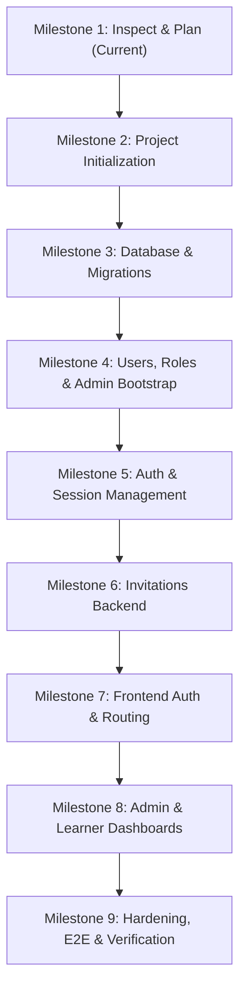

# Go Academy --- Phase 1 Milestone Implementation Plan

**Document Version:** 1.0  
**Phase Target:** Phase 1 --- Platform Foundation  
**Status:** Under Review  

---

## 1. Overview of Phase 1 Scope

Phase 1 establishes the production-grade foundation of the Go Academy platform:
- Core Go modular monolith structure with Chi router and `pgxpool`.
- React + TypeScript + Vite frontend with Tailwind CSS and dark-first developer theme.
- PostgreSQL database schemas with `golang-migrate` and type-safe `sqlc` queries.
- User authentication via Argon2id, short-lived JWTs, and rotating opaque refresh tokens with reuse detection.
- Admin bootstrap CLI tool (no public bootstrap HTTP endpoint).
- Invite-only registration flow with single-use hashed tokens and transactional acceptance.
- Administrative user and invitation management interfaces.
- Learner dashboard shell and role-aware navigation.
- Health probes, Docker Compose environment, comprehensive unit & integration tests.

---

## 2. Milestone Breakdown & Delivery Plan

### Milestone 1: Inspect and Plan (Current Milestone)
- **Status:** Complete, ready for review.
- **Deliverables:**
  - `docs/product-specification.md`: Approved requirements and technical specifications.
  - `docs/architecture.md`: Modular monolith design, backend/frontend layout, code execution boundary.
  - `docs/database.md`: Complete ER diagram, PostgreSQL schemas, constraints, indexes, migration/SQLC strategy.
  - `docs/api.md`: REST API `/api/v1` contracts, standard envelopes, status codes, endpoint schemas.
  - `docs/security.md`: Argon2id, JWT/refresh rotation, reuse detection, RBAC, CSRF/CORS, rate limiting, runner sandbox rules.
  - `docs/milestone-plan.md`: Milestone roadmap, assumptions, and unresolved decisions.
- **Verification:** Inspection of existing directory, tool verification (Go 1.27+, Node v22+, Docker Compose), architectural review.

### Milestone 2: Initialize Project
- **Scope:**
  - Initialize Go module `go-academy/backend` with Chi, pgx, slog, and config validation.
  - Initialize React + TypeScript application with Vite under `go-academy/frontend`.
  - Configure Tailwind CSS, dark-first color tokens, and shadcn/ui components.
  - Create root configuration files: `.env.example`, `.gitignore`, `README.md`.
  - Implement basic HTTP server with `/health/live` and structured logging.
  - Verify backend and frontend clean build.
- **Exit Criteria:** `go build` and `npm run build` succeed without errors.

### Milestone 3: Database & Migrations
- **Scope:**
  - Create `docker-compose.yml` with PostgreSQL 16 service and persistent volume.
  - Write initial migration `000001_initial_schema.up.sql` covering users, roles, user_roles, invitations, refresh_sessions.
  - Configure `sqlc.yaml` and author initial SQL queries in `backend/queries/`.
  - Implement database connection pool (`pgxpool`) and migration runner in `backend/internal/database`.
  - Add `/health/ready` endpoint verifying database connection ping.
  - Verify migration execution from clean database.
- **Exit Criteria:** Migrations apply cleanly; SQLC generates type-safe Go code; readiness probe returns 200 OK.

### Milestone 4: Users, Roles, Admin Bootstrap CLI
- **Scope:**
  - Implement `roles` seeding (`admin`, `learner`).
  - Implement Argon2id password hashing package in `backend/internal/platform/hasher`.
  - Implement user repository and service methods.
  - Build `backend/cmd/admin/main.go` bootstrap command to create the initial admin account safely via CLI.
  - Enforce bootstrap safety (aborts if an admin already exists).
  - Add unit tests for password hashing and bootstrap logic.
- **Exit Criteria:** First admin can be bootstrapped via CLI; duplicate bootstrap is prevented; unit tests pass.

### Milestone 5: Authentication & Session Management
- **Scope:**
  - Implement JWT token generator and validator in `backend/internal/auth`.
  - Implement high-entropy opaque refresh tokens (32 bytes `crypto/rand`) and SHA-256 hash storage.
  - Implement endpoints: `POST /api/v1/auth/login`, `POST /api/v1/auth/refresh`, `POST /api/v1/auth/logout`, `GET /api/v1/auth/me`.
  - Implement refresh token rotation and token family reuse detection (immediate family revocation).
  - Configure `HttpOnly`, `SameSite=Lax`, `Secure` cookies for refresh tokens.
  - Add rate limiting middleware for `/auth/login`.
  - Integration tests for login, refresh rotation, reuse detection, disabled account lockout.
- **Exit Criteria:** Secure authentication cycle works; refresh rotation and reuse detection verified by tests.

### Milestone 6: Invitations Backend
- **Scope:**
  - Implement admin invitation endpoints: `POST /api/v1/admin/invitations`, `GET /api/v1/admin/invitations`, `DELETE /api/v1/admin/invitations/{id}`.
  - Implement cryptographic token generation (SHA-256 hash stored in DB, raw token returned once).
  - Implement `POST /api/v1/auth/register` accepting an invitation and creating the user within a single database transaction.
  - Validate expiration (default 7 days), revocation, and email matching.
  - Add backend integration tests for invitation creation, acceptance, duplicate acceptance prevention, and revocation.
- **Exit Criteria:** Invitations can be created, inspected, revoked, and accepted transactionally; tests pass.

### Milestone 7: Frontend Authentication & Routing
- **Scope:**
  - Setup TanStack Query, Axios/Fetch API client with auth interceptor.
  - Build Auth Layout, Login page (`/login`), and Invitation Registration page (`/register?token=...`).
  - Implement protected routes and role-based guards (`RequireAuth`, `RequireAdmin`).
  - Implement loading states, validation error messages (Zod + React Hook Form), and toast notifications.
  - Add frontend component and route tests.
- **Exit Criteria:** Learner and admin can log in; invited users can register via link; invalid states handled cleanly.

### Milestone 8: Admin & Learner Dashboards
- **Scope:**
  - Build App Shell with dark-first sidebar navigation and header user menu.
  - Build Learner Dashboard shell with welcome banner, streak placeholder, and learning path cards.
  - Build Admin Invitations page: list invitations, create invitation modal with copy-link feature, revoke action.
  - Build Admin Users page: list users, filter by status, toggle activate/deactivate account.
  - Verify that learner role cannot access `/admin/*` routes or backend endpoints (403 Forbidden).
- **Exit Criteria:** Admin can manage invitations and users in the UI; learner sees learner dashboard; access control strictly verified.

### Milestone 9: Hardening & Verification
- **Scope:**
  - Run full Go test suite (`go test -race ./...`).
  - Run frontend test suite (`npm run test`) and linter.
  - Review security configurations: CORS headers, cookie attributes, body size limits, log masking.
  - Validate Docker Compose end-to-end setup from a fresh environment.
  - Complete documentation and update `README.md`.
- **Exit Criteria:** All definition of done criteria for Phase 1 are satisfied.

---

## 3. Assumptions and Unresolved Decisions

### 3.1 Assumptions
1. **Monorepo Root:** The project is created under `go-academy/` inside the active workspace `/home/bikash.bhattarai@infodevelopers.local/Code/vibe-code`.
2. **Environment & Tooling:** Go 1.27.1, Node.js 22.19, npm 10.9, Docker Compose 5.1.4 are available on the host system.
3. **Database Port:** PostgreSQL will bind to port `5432` by default (configurable via `.env` if local conflicts occur).
4. **Email Delivery:** In Phase 1, automated transactional emails (SMTP/SES) are out of scope as approved; administrators copy the generated invitation link from the UI or API response.
5. **Code Execution:** Code execution engine (`/run` and `/submit`) is explicitly deferred to Phase 5; Phase 1 will not pretend to run code or return fake execution results.
6. **Dark Theme:** Dark theme is the default and only active theme for Phase 1 to ensure a clean, focused developer aesthetic.

### 3.2 Unresolved Decisions for User Review
1. **Session Cookie Security in Local Development:**
   - *Proposal:* Set `Secure=false` when `APP_ENV=development` and `Secure=true` in production to allow testing over plain HTTP on `localhost`.
2. **Rate Limiting Storage:**
   - *Proposal:* Use an in-memory token bucket rate limiter (e.g. `golang.org/x/time/rate`) for Phase 1 since the backend is a single modular monolith process, avoiding an external Redis dependency.
3. **Admin Bootstrap CLI Interface:**
   - *Proposal:* Provide both CLI flags (`--email`, `--username`, `--password`) and an interactive prompt (reading password without echo) for administrator creation in `cmd/admin`.
